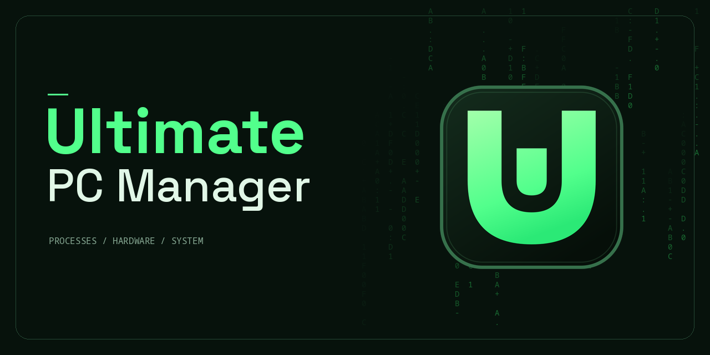

# Ultimate PC Manager



[](https://github.com/SpatariuRares/ultimate-pc-manager)
[](https://buymeacoffee.com/spatariurares)

If you find the app useful, you can support its development on
[Buy me a coffee](https://buymeacoffee.com/spatariurares). Settings has a
**GitHub** button (the repository) and a **Buy me a coffee** button too.

Task manager for Windows written in Rust with [egui](https://github.com/emilk/egui).
It includes the Summary, Performance, Processes, System Info, App history,
Startup apps, Users, Services, Power & Freq, Flight Recorder, Connections,
Installed Apps, Drivers, Disk Space, Benchmarks, Package Manager, Settings and
Colors pages, plus other features such as app and driver updates.

> Earlier versions were called **My Task Manager**. At the first start, the app
> renames the old `MyTaskManager` data folders to `UltimatePCManager`, so settings
> and histories are kept.

The Michroma font (`assets/`) is licensed under the SIL Open Font License
(`assets/Michroma-OFL.txt`).

The brand assets (icon, symbol, wordmarks, banner and palette) are in
`assets/brand/`; `assets/brand/palette.md` describes them. The wordmark uses
Space Grotesk (SIL Open Font License, `assets/brand/OFL-SpaceGrotesk.txt`); the
app draws the wordmark from PNG files and does not load the font.

## Requirements

- **Windows 10 or 11, 64-bit.** The pages read Windows data (registry,
  performance counters, services, drivers); it is the only supported system.
- **Stable Rust with the MSVC toolchain**, installed with [rustup](https://rustup.rs).
  Tested with Rust 1.96.0 (`stable-x86_64-pc-windows-msvc`).
- **Visual Studio Build Tools** with the *Desktop development with C++*
  workload: this provides the MSVC linker and the Windows SDK. The rustup
  installer offers it if it is missing.

Optional, only for some features:

- **winget** (App Installer, from the Microsoft Store) to search for and install
  new versions of apps on the Installed Apps page.
- **Administrator rights** to install drivers, stop services and drivers, and
  scan hardware. The app should not be started as administrator: when needed,
  Windows asks for it with the UAC window.

## Build

```powershell
cargo build --release
```

The executable is `target\release\ultimate-pc-manager.exe`. The first build downloads
the dependencies and takes a few minutes; later builds are incremental.

The debug build (`cargo build`) also opens a console window, useful for reading
messages; the release build does not.

## Launch

```powershell
cargo run --release
```

or run `target\release\ultimate-pc-manager.exe` directly.

Command-line options:

| Option | Effect |
|---|---|
| `--page "<name>"` | Opens the given page, for example `--page "Installed Apps"` or `--page "Power & Freq"`. The names are those of the side menu, plus `Settings` and `Colors`. |
| `--screenshot <file.png>` | Waits for the first two performance samples, saves an image of the window to the given file and closes the app. It does not wait for the lists that load in the background (drivers, installed apps): on those pages the capture may show "Reading…". |
| `--theme dark\|light` | Uses the dark or light theme only for this run, without changing the saved one (useful with `--screenshot`). A theme chosen in Settings while the app is running is saved. |

Example, a capture of the Drivers page, also in the light theme:

```powershell
cargo run --release -- --page "Drivers" --screenshot shots\drivers.png
cargo run --release -- --page "Drivers" --theme light --screenshot shots\drivers-light.png
```

## Test

```powershell
cargo test --release
```

Runs the unit tests, which do not touch the system. Other tests read this PC's
real data and are excluded by default:

```powershell
# List of installed apps, last launch and comparison with winget
cargo test --release apps::tests::lists_this_pc -- --ignored --nocapture

# List of device drivers and kernel drivers
cargo test --release drivers::tests::lists_this_pc -- --ignored --nocapture

# Driver search on Windows Update (10–60 seconds, requires network)
cargo test --release checks_windows_update -- --ignored --nocapture
```

The real benchmarks print their numbers, which are only valid in a release build
(`--release`):

```powershell
# CPU: 2 seconds on one core, then 2 seconds on all cores
cargo test --release cpu_test_on_this_pc -- --ignored --nocapture

# Disk: writes and reads a 256 MB file in the temporary folder, then deletes it
cargo test --release disk_test_on_this_pc -- --ignored --nocapture

# GPU (Direct3D 11): lists the cards and tests the high-performance one;
# BENCH_GPU (part of the name) chooses a different one
$env:BENCH_GPU = "Radeon"; cargo test --release gpu_test_on_this_pc -- --ignored --nocapture

# Internet: download and upload to speed.cloudflare.com (requires network)
cargo test --release measures_this_connection_against_cloudflare -- --ignored --nocapture
```

With the `APPS_DUMP` variable, the first test also writes a JSON file with all
the apps and the measured sizes of their folders:

```powershell
$env:APPS_DUMP = "$env:TEMP\apps.json"; cargo test --release apps::tests::lists_this_pc -- --ignored
```

## CI/CD

GitHub Actions on `windows-latest` (the app only builds with MSVC), kept to a
minimum of runner minutes:

| Workflow | When | What it does |
|---|---|---|
| `.github/workflows/ci.yml` | pull requests that change `src/`, `assets/`, `Cargo.toml`/`Cargo.lock` or the workflow; manual | `cargo test --release` only (tests that read the real PC are `#[ignore]` and skipped). Doc-only changes and pushes to `main` do not run it. |
| `.github/workflows/release.yml` | push of a `v*` tag | `cargo build --release` and a GitHub Release with `ultimate-pc-manager-<tag>-windows-x64.zip` (exe, README, font license). |

Both have a 30-minute timeout and reuse the Cargo cache. To publish a version:

```powershell
git tag v0.2.0
git push origin v0.2.0
```

## Where the app writes

| Path | Content |
|---|---|
| `%APPDATA%\UltimatePCManager\settings.json` | Settings: theme, update speed, start page, colors. |
| `%APPDATA%\UltimatePCManager\benchmark-history.json` | History of completed benchmarks (not in debug builds). An unreadable file is set aside as `benchmark-history.unreadable-<seconds>.json`. |
| `%LOCALAPPDATA%\UltimatePCManager\jobs\` | Temporary PowerShell scripts for Windows Update, pnputil and the Store app list. They are deleted when the job finishes. |
| `<test folder>\.ultimate-pc-manager-disk-benchmark-<pid>` | Hidden 256 MB file used by the disk benchmark (by default in the temporary folder). It is deleted at the end of the test; files left behind by an interrupted run are deleted at the next test. |
| `Documents\flight-recording-*.csv` | Flight Recorder recordings saved by the user. |

## Code structure

| File | Content |
|---|---|
| `build.rs` | Embeds `assets/brand/icon.ico` and the version details into the Windows executable. |
| `src/main.rs` | Startup, window and its icon, command-line options. |
| `src/app.rs` | App state, menu, navigation, common dialogs. |
| `src/sampler.rs`, `src/perfdata.rs` | Collection of performance data in a separate thread. |
| `src/proc_info.rs` | Per-process threads, handles, peak memory, page faults, CPU time, priority, architecture and the window (App) flag for the sampler; a process's command line, environment and open handles for the Inspector. |
| `src/process_view.rs` | The Processes view: hidden processes (the app itself, Microsoft-signed ones), filter, sort, process tree, Apps / Background groups and parent sums, as lines the page draws. |
| `src/inspector.rs` | The Process Inspector window (properties, command line, environment, open resources), read on a worker thread. |
| `src/wait_chain.rs` | Analyze wait chain: Wait Chain Traversal over a process's threads on a worker thread, and the window with the six counts. |
| `src/file_activity.rs` | The File activity window: a real-time ETW trace (Microsoft-Windows-Kernel-File) of one process's opens, reads, writes, deletes and renames, aggregated into Recent activity and Totals per file; the session never outlives the window. |
| `src/settings.rs` | Saved settings and the chart colors chosen by the user. |
| `src/path_cache.rs` | A cache of one fact per file path, read once per path on a worker thread (ask, then read what is known); the signatures and the descriptions are kept in it. |
| `src/signature.rs` | Who signed a program file (WinVerifyTrust, embedded or catalog), checked once per path on a worker thread; used by "Hide Microsoft Services and Processes" and the Publisher column. |
| `src/version_info.rs` | A program file's description from its version details, read once per path on a worker thread; used by the Description column. |
| `src/theme.rs` | Design A theme: colors by role in the dark and light themes, chart palette, fonts; the only place where colors are defined. |
| `src/page_perf.rs` | Performance page. |
| `src/core_page.rs` | The interface every core page shares (its own state, a new sample, refresh, drawing) and the order a sample reaches the pages in. |
| `src/page_summary.rs`, `src/summary_view.rs`, `src/summary_tiles.rs` | Summary. |
| `src/page_processes.rs` | Processes. |
| `src/page_system.rs`, `src/page_users.rs` | System Info, Users. |
| `src/page_settings.rs`, `src/page_colors.rs` | Settings, Settings › Add-ons, Colors. |
| `src/page_services.rs`, `src/page_startup.rs`, `src/page_history.rs`, `src/list_pages.rs` | Services, Startup apps, App history, and what the three share (`list_pages.rs`). |
| `src/addons.rs`, `src/addons/` | Add-on registry and their pages: Power & Freq, Flight Recorder, Connections, Installed Apps, Drivers, Disk Space, Benchmarks. |
| `src/platform.rs`, `src/sensors.rs`, `src/sensors/` | Services shared by the add-ons (actions, PowerShell, sensors). |
| `src/pro.rs` | Local clock and ISO-8601 dates of the histories. |
| `src/winsys.rs` | Services, automatic startup, priorities and other Windows actions. |
| `src/widgets.rs` | Charts, icons and parts of the app frame. |
| `src/widgets/parts.rs` | Shared parts of design A: buttons, filter groups, status band, tables, side panel. |
